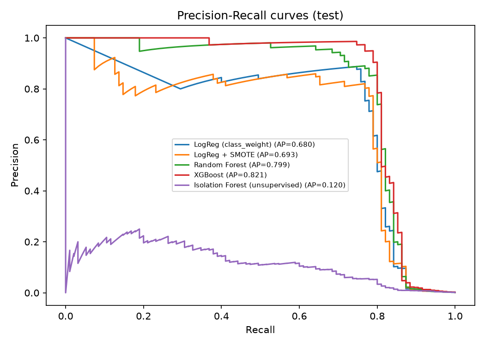
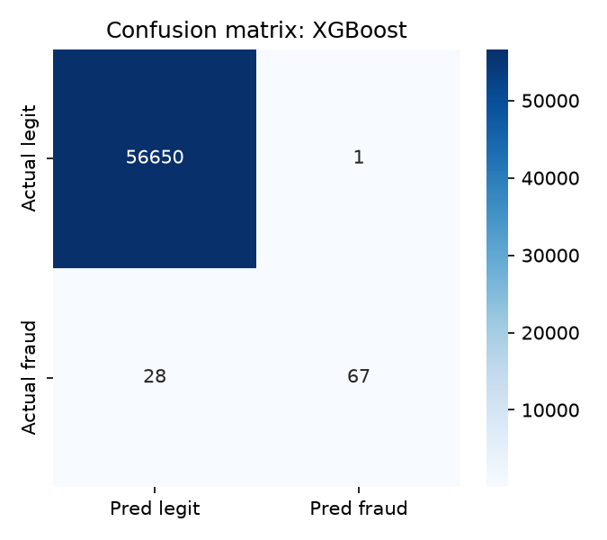
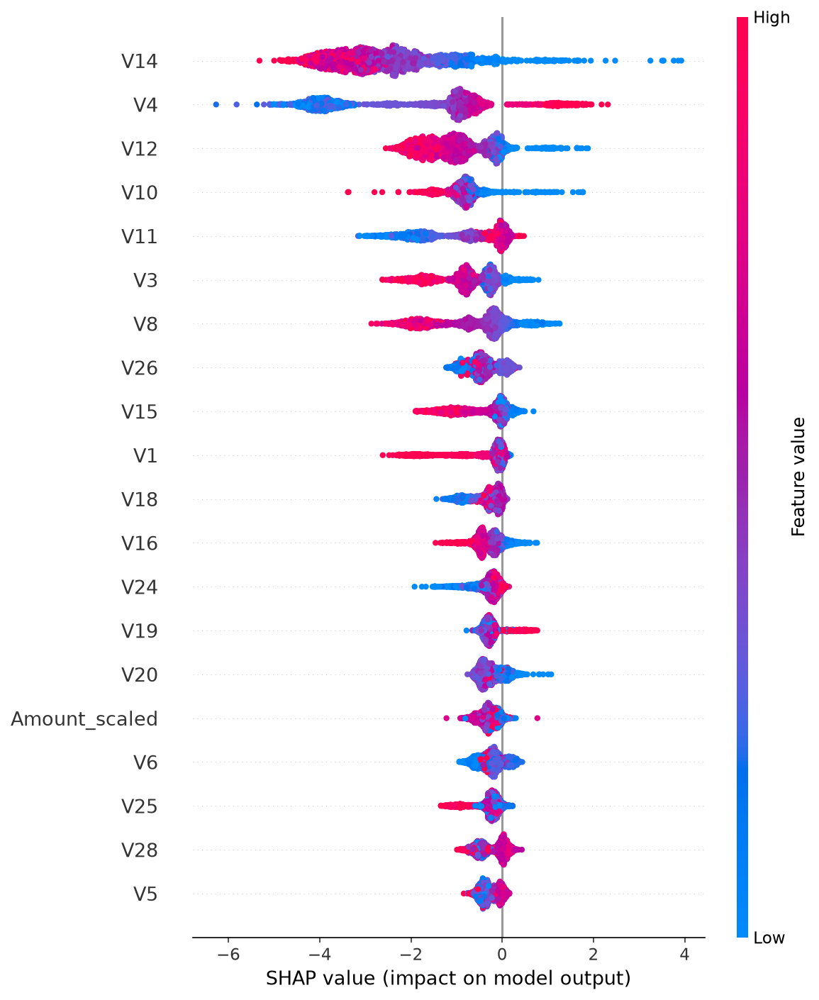

# 💳 Credit Card Fraud Detection
Live Demo : https://credit-card-fraud-detection-vbe7uv2hkhctdzpxyw76k7.streamlit.app/
End-to-end machine learning project that detects fraudulent credit card transactions
in a highly imbalanced dataset (~0.17% fraud). It compares supervised and unsupervised
models, tunes the decision threshold for business use, explains predictions with SHAP,
and ships a Streamlit demo app.

## Highlights
- Dataset: [Kaggle Credit Card Fraud](https://www.kaggle.com/datasets/mlg-ulb/creditcardfraud/data) – 284,807 transactions (283,726 after removing duplicates), 473 frauds (0.17%)
- Handles class imbalance: class weights, SMOTE (train only), `scale_pos_weight`
- Models: Logistic Regression (2 variants), Random Forest, XGBoost, Isolation Forest
- Metrics for imbalanced data: **PR-AUC, precision, recall, F1** (not accuracy)
- Leak-free: scaler/SMOTE fit on train only; 60/20/20 train/val/test split;
  threshold and model chosen on validation, final numbers on untouched test set
- Explainability with SHAP, and a Streamlit app for scoring uploaded transactions

## Results


Evaluated on a held-out test set of 56,746 transactions (95 frauds). The decision threshold was tuned on a separate validation set, and the best model was selected by validation PR-AUC.

| Model | ROC-AUC | PR-AUC | Precision | Recall | F1 |
|---|---|---|---|---|---|
| Logistic Regression (class weights) | 0.961 | 0.680 | 0.877 | 0.747 | 0.807 |
| Logistic Regression + SMOTE | 0.957 | 0.693 | 0.820 | 0.768 | 0.794 |
| Random Forest | 0.953 | 0.800 | 0.932 | 0.716 | 0.810 |
| **XGBoost (best)** | **0.973** | **0.821** | **0.985** | 0.705 | **0.822** |
| Isolation Forest (unsupervised) | 0.943 | 0.120 | 0.168 | 0.347 | 0.227 |

**Best model: XGBoost**
- Flagged 68 transactions, of which 67 were real fraud (1 false alarm out of 56,746 legitimate and fraudulent transactions).
- Caught 67 of 95 frauds (70.5% recall), covering about 60% of the fraudulent amount.
- Supervised models clearly beat the unsupervised Isolation Forest baseline on PR-AUC.

**Key takeaways**
- PR-AUC is the headline metric because ROC-AUC looks high for every model on such imbalanced data (0.17% fraud).
- The threshold is tuned for F1, which favors precision. A bank that prefers catching more fraud can lower the threshold in the Streamlit app and accept more false alarms.
- The test set contains only 95 frauds, so metrics can shift by a few points with a different random split.

### Figures





## Project structure
```
credit-card-fraud-detection/
├── app.py                    # Streamlit demo
├── requirements.txt
├── data/                     # put creditcard.csv here (not committed)
├── models/                   # trained model saved here
├── reports/                  # metrics + figures
├── notebooks/                # optional EDA notebook
└── src/
    ├── features.py           # feature engineering (shared by train & predict)
    ├── train.py              # full training + evaluation pipeline
    ├── predict.py            # batch scoring from CLI
    └── generate_sample_data.py  # synthetic data for quick pipeline tests
```

## How to run
```bash
git clone https://github.com/<your-username>/credit-card-fraud-detection.git
cd credit-card-fraud-detection
python -m venv venv && source venv/bin/activate    # Windows: venv\Scripts\activate
pip install -r requirements.txt

# 1. Download creditcard.csv from Kaggle and place it in data/
# 2. Train and evaluate
python -m src.train --data data/creditcard.csv
# 3. Score transactions
python -m src.predict --input data/sample_transactions.csv --output predictions.csv
# 4. Launch the demo
streamlit run app.py
```
No Kaggle access yet? `python -m src.generate_sample_data` creates a synthetic file with the
same schema so you can test the pipeline (results will differ from real data).

## Method
1. **EDA** – class imbalance, amount distribution, fraud rate by hour.
2. **Features** – `Hour` from `Time`; `log1p(Amount)` + RobustScaler. V1–V28 are already PCA components.
3. **Imbalance** – class weights, SMOTE on train only, XGBoost `scale_pos_weight`.
4. **Evaluation** – PR-AUC is the headline metric. Threshold is tuned for F1 on the validation set.
5. **Business view** – share of fraudulent amount caught vs. number of false alarms.
6. **Explainability** – SHAP summary shows which features drive fraud scores.

## Limitations & future work
- Features are anonymised PCA components, so business-level interpretation is limited.
- Data covers two days; real systems face concept drift and need retraining/monitoring.
- Add cost-sensitive thresholding (cost of missed fraud vs. cost of a false alarm).
- Try LightGBM, hyperparameter tuning (Optuna), autoencoders, and an API (FastAPI) deployment.
